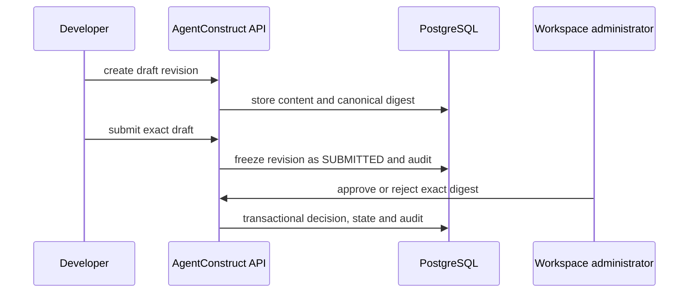

# Plan Approval Architecture

The customer planning path is deliberately separate from the existing local execution-plan path.

The API verifies tenant membership and role on every operation. A customer plan decision does not grant GitHub or AWS access and does not trigger deployment.
