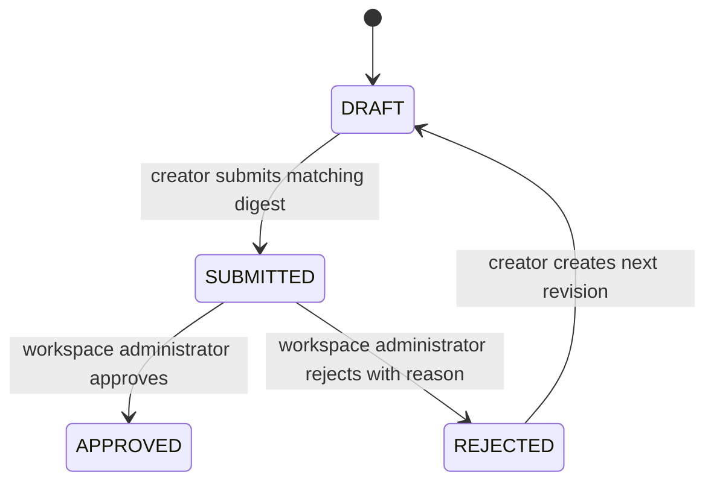

# Plan Lifecycle

Only a submitted revision can be decided. A decision stores the exact digest, creator, approver, timestamp and policy. PostgreSQL locks the revision while it is submitted or decided, and the decision table permits only one decision per revision. Administrators may self-approve; this is explicit, audited and does not override cloud guardrails. Approved means eligible for a later explicit execution action, never deployed.
