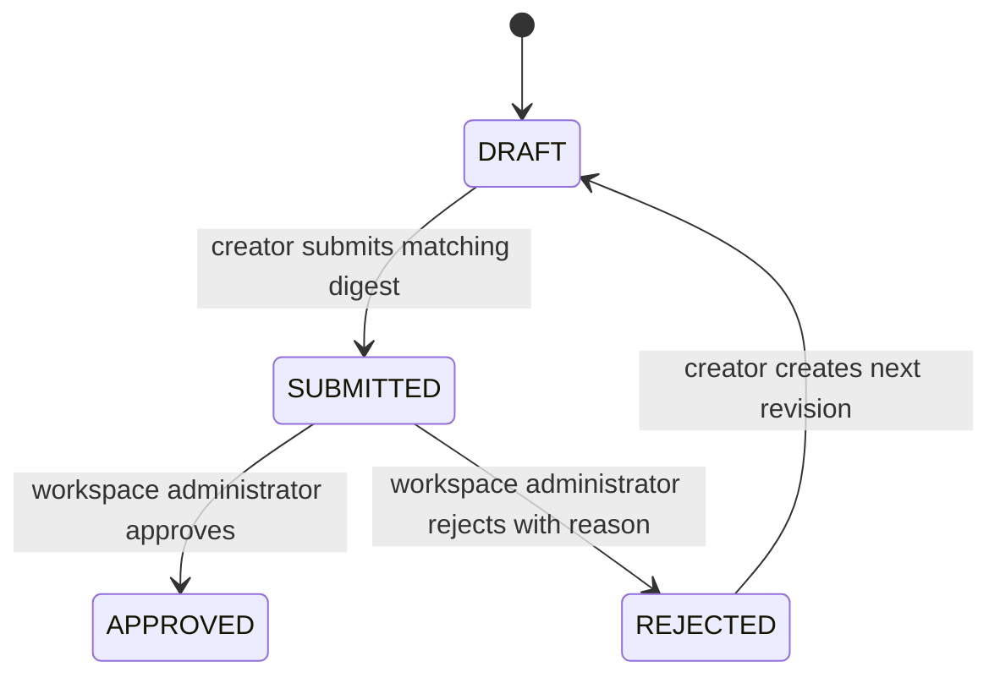

# Plan Lifecycle

Draft and rejected reviews can create a new draft revision from explicit user-edited constraints such as budget, region, environment, data classification, availability, workload type, public/private access and assumption decisions. The previous revision is not edited; the new revision gets its own digest and diff.

Only a submitted revision can be decided. A decision stores the exact digest, creator, approver, timestamp and policy. PostgreSQL locks the revision while it is submitted or decided, and the decision table permits only one decision per revision. Administrators may self-approve; this is explicit, audited and does not override cloud guardrails. Approved means eligible for a later explicit execution action, never deployed.

For the local product demo, that later action is **Execute local dry run**. It converts the approved revision into a bounded fixture execution plan, records the approved revision/digest on each local environment, observes READY/FAILED/DEGRADED independently, and uses the existing destroy-plan approval path for production cleanup. This proves the lifecycle without AWS mutation.
