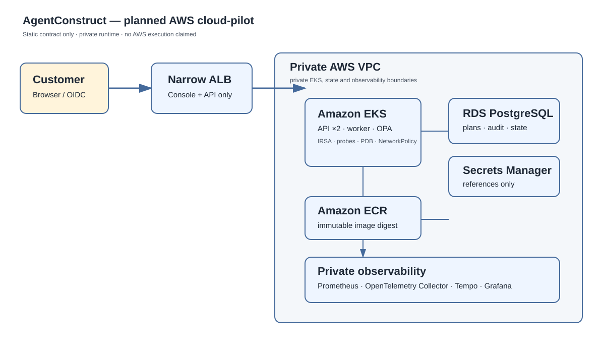

# Cloud-pilot architecture

**State: planned cloud contract. It has not created or changed an AWS resource.**

AgentConstruct will run the product control plane in a private AWS network. A customer uses the product UI/API; they never receive AWS, Kubernetes, Terraform or database credentials.



## What the design does

1. A browser signs in through an approved OIDC provider and reaches only the product Console/API through a narrow load-balancer route when browser access is required.
2. The API verifies tenant and role, calls OPA, stores plans/audit records in private PostgreSQL and writes only reviewed desired state.
3. Argo CD, in a future execution slice, reconciles that desired state into private EKS workloads. The API does not give users `kubectl`, Terraform or AWS credentials.
4. The runtime reads references from Secrets Manager through a least-privilege workload role. Secret values do not go into Git, plans or audit logs.
5. Prometheus, OpenTelemetry Collector, Tempo and Grafana stay private. They observe the product and workload; they are not browser entry points.

## AWS resources planned

| Need | Planned AWS service | Boundary |
| --- | --- | --- |
| Network | VPC, private runtime subnets and a single NAT path | No public workload/database subnet; NAT is a planned cost/security trade-off |
| Runtime | EKS managed node group | Private API endpoint; workload identity through IRSA |
| Images | ECR | Immutable tags and scan-on-push |
| Product state | RDS PostgreSQL | Encrypted, private, seven-day backup setting |
| Secrets | Secrets Manager | References only, with future External Secrets delivery |
| State safety | S3 versioned state bucket and DynamoDB lock | Separate per-repository state namespace |
| Browser access | Narrow ALB, only if the product UI/API requires it | No public Grafana, Tempo, Prometheus, Argo, database or Kubernetes API |

## Delivery sequence

```text
approved DeploymentPlan → reviewed Git change → Argo reconciliation
→ Kubernetes observation → READY or FAILED → audit
```

The Terraform, Kubernetes and Argo files are static contracts. PR 3 will add the future GitHub OIDC operator workflow. A separately authorised cloud pilot must record plan, apply, image publication, runtime bootstrap, smoke, failure evidence, observability, Cost Explorer query, destroy and proof of absence.
