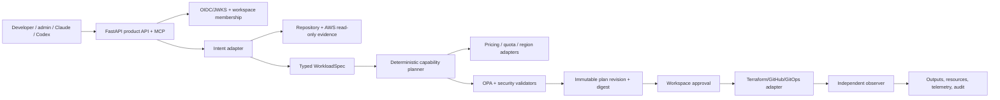

# Proposed architecture

## Target shape

## Retain

- Modular monolith and PostgreSQL model (`apps/api/src/agentconstruct`).
- `WorkloadSpec`, `ArchitecturePlan`, candidate ranking, plan digests, policy, audit and tenant checks.
- GitHub App read-only integration and AWS STS discovery boundary.
- Local fixture worker, output/resource models, execution history, MCP and CLI surfaces.
- Terraform as a possible backend, not as the product’s decision model.

## Refactor or introduce

1. **Evidence layer:** repository analyzer, AWS inventory, AWS Pricing API/catalog snapshots, region/service quota/availability checks, and provenance records.
2. **Requirement layer:** model adapter produces a typed extraction with `KNOWN`, `INFERRED`, `UNKNOWN`, or `USER_CONFIRMED` status per material field.
3. **Capability catalog:** normalized compute/data/network/security/operations/AI capabilities mapped to AWS resources.
4. **Deterministic evaluator:** hard constraints first; candidate generation; cost and complexity; security/reliability checks; recommendation and rejected alternatives.
5. **Execution adapter:** renders a selected profile, performs policy/preflight, executes only with explicit authorization, captures outputs, observes independently, and supports destroy.
6. **Evaluation harness:** scenario fixtures, golden expert decisions, automated schema/policy/Terraform checks, and regression reports.

## Data and versioning rules

- Store the canonical `WorkloadSpec`, evidence references, planner/catalog version, pricing timestamp, policy bundle version, candidate set, selected plan, and digest.
- Never overwrite a submitted/approved revision.
- Record whether a value came from user text, repository evidence, AWS API, pricing catalog, model inference, or default.
- Treat live pricing and inventory as time-bounded evidence, not permanent truth.

## Provider strategy

Keep provider-neutral interfaces, but implement AWS deeply. Do not implement Azure/GCP/OCI adapters until AWS scenarios, evidence and economics are proven. A provider-neutral plan schema is useful; a multi-cloud runtime is not an MVP requirement.

## Expensive-to-reverse decisions

- Keep approval and execution separate.
- Keep cloud credentials short-lived and scoped.
- Keep the architecture profile/provider boundary explicit.
- Keep raw model output out of authority paths.
- Keep customer data and evaluation consent separate.
- Keep the model provider replaceable.

