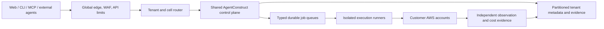

# Scale and multi-tenancy goal

## Goal

AgentConstruct is being designed to support millions of customer identities over time without turning every customer into a bespoke deployment. The goal is not to provision million-customer infrastructure now. The goal is to make the boundaries that determine future scale explicit before implementation hardens around a single tenant, single queue, single database, or single execution process.

## Scale dimensions

Capacity must be measured separately for:

- active users and concurrent sessions;
- planning/model requests;
- GitHub webhook and repository events;
- AWS discovery requests;
- Terraform/GitOps execution jobs;
- telemetry, audit and evidence events;
- connected accounts, projects and environments;
- billing and usage records.

Registered-user count alone is not a capacity model.

## Target control-plane shape

## Invariants to implement now

1. Every request, record, job, artifact, metric and audit event carries organization/workspace/project/environment scope.
2. Model output is never execution authority.
3. Execution is isolated from the API process and uses short-lived credentials.
4. Job transport is replaceable: PostgreSQL locally, managed queues when load requires them.
5. Provider, model, pricing, policy and execution adapters are versioned interfaces.
6. Submitted plans and evidence are immutable; new knowledge creates a new revision.
7. Customer data is retained, exported and deleted according to explicit policy.
8. Tenant routing can later select a region/cell without changing business contracts.

## Scale evolution

### Local and early hosted

- Modular FastAPI application.
- RDS PostgreSQL.
- Database-backed worker queue.
- App Runner or ECS/Fargate.
- Single AWS region.
- Deterministic fixture providers plus read-only live adapters.

### Growth

- SQS/EventBridge-backed typed queues.
- Separate planning, integration, execution and observation workers.
- Read models and cache for dashboards.
- Usage metering, quotas and entitlements.
- Tenant-aware rate limits and concurrency controls.
- Cell metadata and regional routing.

### Large-scale and enterprise

- Multiple control-plane cells and regional data boundaries.
- Pooled, bridge and silo tenant isolation tiers.
- Private outbound execution agents for restricted networks.
- Cross-region recovery and tenant migration.
- Enterprise identity, retention, audit export and compliance operations.

## Product moat

The scalable asset is not only the API fleet. It is the customer-specific infrastructure evidence graph: repository facts, inventory, policies, plans, approvals, observed resources, incidents, costs and outcomes. It must be tenant-scoped, provenance-aware and portable across model providers and execution backends.

## Non-goals for the current phase

- No Kafka or Kubernetes control plane merely for appearance.
- No active/active multi-region deployment before usage and recovery requirements justify it.
- No per-customer VPC or account by default.
- No autonomous remediation of protected production environments.
- No foundation-model training.

